# op-devops

一套基于微服务架构的运维平台：主机资产管理、Web 终端、会话审计、计划任务，以及统一的账号与权限体系。

后端每个业务模块都是独立项目，结构一致：对外是 **FastAPI 网关**，对内是 **gRPC 服务**，用 **Nacos** 做服务发现和配置中心，**APISIX** 统一承接南北向流量。前端基于 **Vue 3 + Vben Admin + Element Plus**。

## 功能

| 模块 | 能做什么 |
|---|---|
| **账号权限** | 图形验证码登录；账号、角色管理；按「模块.页面.动作」三级权限码授权；角色按主机分类划定可见范围；登录日志、强制下线 |
| **主机管理** | 主机与分类的增删改查；平台全局密钥 / 主机独立密钥；SSH 连通性验证（首次验证自动下发公钥） |
| **Web 终端** | 浏览器内 SSH，多页签保持连接；`trzsz` 上传下载文件；页面水印标注当前操作人与目标主机 |
| **会话审计** | 终端会话全程录像回放（asciinema）；命令审计；在线会话实时监控 |
| **计划任务** | 间隔、一次性、UNIX Cron 三种触发方式；多主机批量执行；钉钉、飞书、企业微信、Webhook 失败通知 |

## 架构

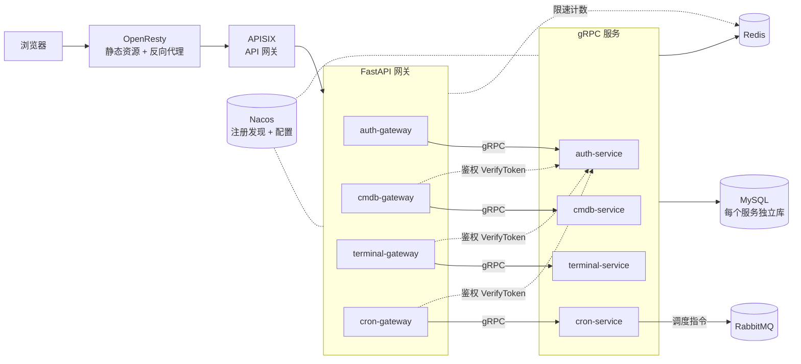

- **请求链路**：浏览器 → OpenResty → APISIX → 各模块网关 → gRPC 服务。网关以随机端口注册到 Nacos，由 APISIX 服务发现，前端不需要知道服务具体在哪。
- **统一鉴权**：各业务网关调用 `auth-service` 的 `VerifyToken` 校验登录态和权限码，业务服务自己不保存用户信息。
- **存储隔离**：MySQL、Redis 是全局共享的一套，每个服务用自己的库和只有 DML 权限的账号，Redis 按 db 编号隔开；表结构变更走 Alembic，由 DBA 账号单独执行。
- **配置集中**：运行配置全部放在 Nacos，服务只靠 `NACOS_*` 环境变量引导，大部分配置支持热更新。
- **契约优先**：跨服务调用只共享 `.proto`，通过 `contracts` 仓库分发，各项目自己生成 stub。

## 仓库

| 仓库 | 说明 |
|---|---|
| [web](https://github.com/op-devops/web) | 前端，Vue 3 + Vben Admin + Element Plus |
| [auth](https://github.com/op-devops/auth) | 统一认证：登录、账号、角色、权限码 |
| [cmdb](https://github.com/op-devops/cmdb) | 主机资产：主机、分类、SSH 密钥 |
| [terminal](https://github.com/op-devops/terminal) | Web 终端、会话录像、命令审计、实时监控 |
| [cron](https://github.com/op-devops/cron) | 计划任务 |
| [contracts](https://github.com/op-devops/contracts) | 跨服务 gRPC 契约（`.proto`）的分发点 |
| [infra](https://github.com/op-devops/infra) | 全局中间件栈：Nacos、MySQL、Redis、RabbitMQ、APISIX |
| [scaffold](https://github.com/op-devops/scaffold) | 微服务脚手架，交互式生成「FastAPI 网关 + gRPC 服务 + Nacos」骨架 |

## 技术栈

- **后端**：Python · FastAPI · gRPC · SQLAlchemy · Alembic
- **前端**：Vue 3 · TypeScript · Vite · Vben Admin · Element Plus · xterm.js
- **中间件**：Nacos · APISIX + etcd · MySQL · Redis · RabbitMQ · OpenResty
- **部署**：Docker Compose

## 快速开始

```bash
# 1. 起全局中间件（Nacos / MySQL / Redis / RabbitMQ / APISIX），同时创建 devops-net 网络
cd infra && ./init-data-dirs.sh && docker compose up -d

# 2. 依次起各业务模块（以 auth 为例，cmdb / terminal / cron 同理）
cd auth
cp .env.example .env
python3 dev.py db-init       # 在共享库上建库 + DML 账号（每个项目一次）
python3 dev.py db-upgrade    # 建表
python3 dev.py up

# 3. 起前端
cd web && pnpm install && pnpm dev:ele    # http://localhost:5777
```

各模块的详细说明见对应仓库的 README。

## 截图

<table>
  <tr>
    <td width="50%">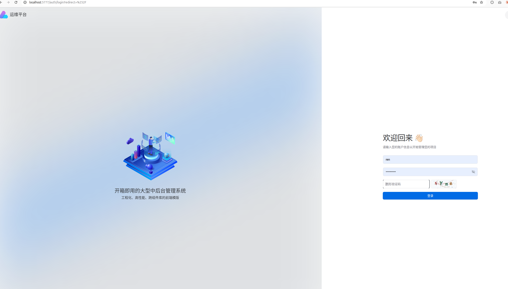<p align="center">登录（图形验证码）</p></td>
    <td width="50%">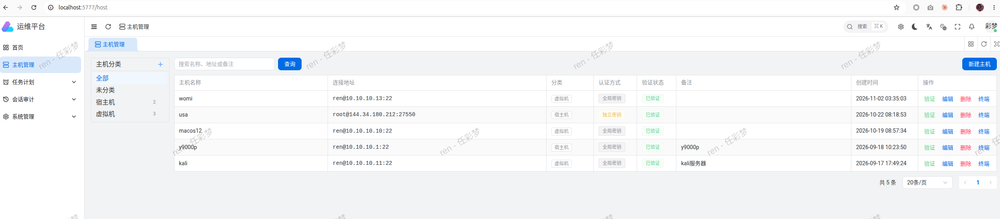<p align="center">主机管理</p></td>
  </tr>
  <tr>
    <td>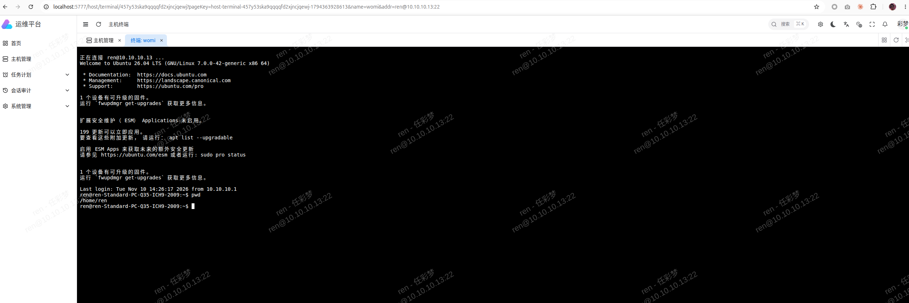<p align="center">Web 终端</p></td>
    <td>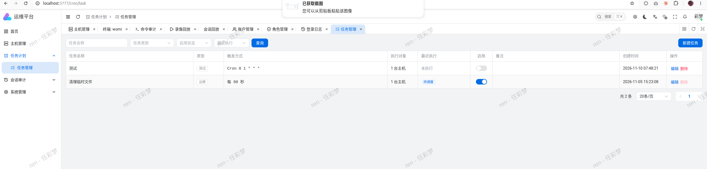<p align="center">计划任务</p></td>
  </tr>
  <tr>
    <td>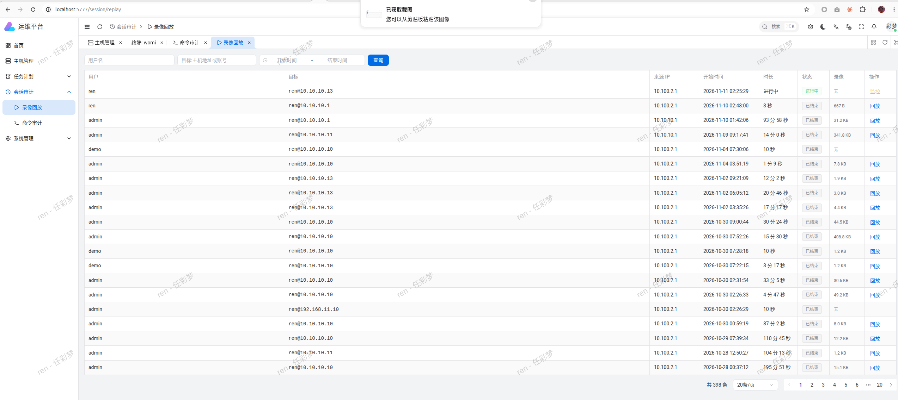<p align="center">会话录像列表</p></td>
    <td><p align="center">会话回放</p></td>
  </tr>
  <tr>
    <td>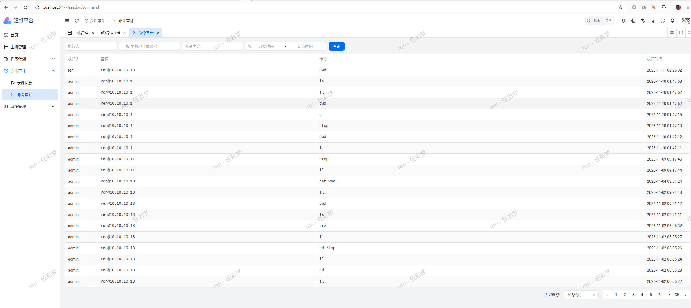<p align="center">命令审计</p></td>
    <td>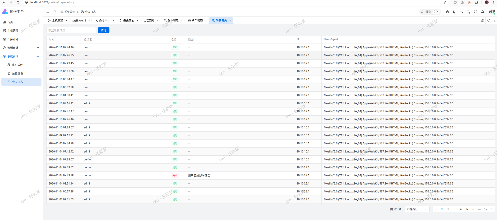<p align="center">登录日志</p></td>
  </tr>
  <tr>
    <td>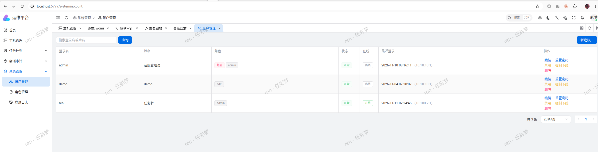<p align="center">账户管理</p></td>
    <td>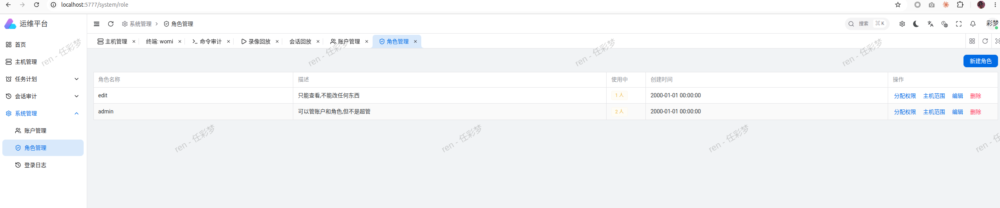<p align="center">角色管理</p></td>
  </tr>
  <tr>
    <td>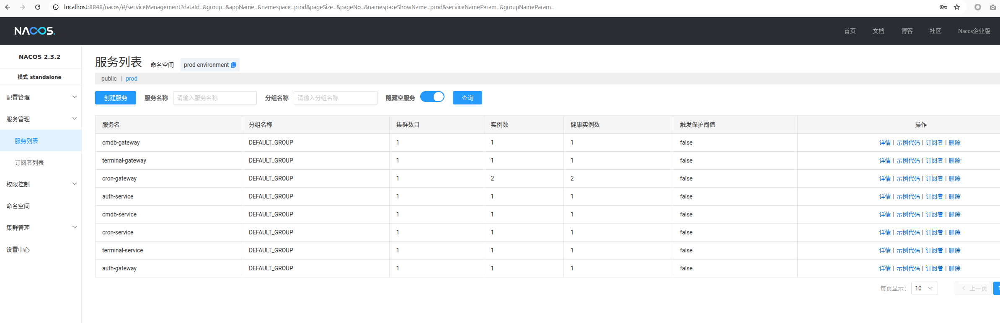<p align="center">Nacos：网关与服务注册情况</p></td>
    <td>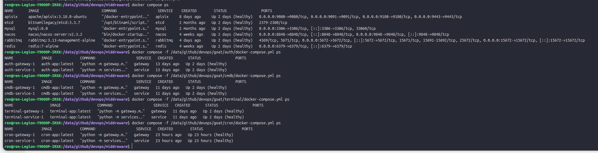<p align="center">中间件与各服务容器运行状态</p></td>
  </tr>
</table>
